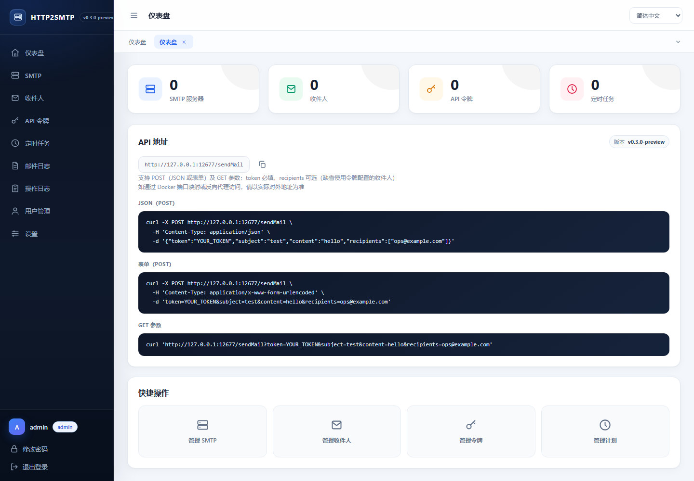
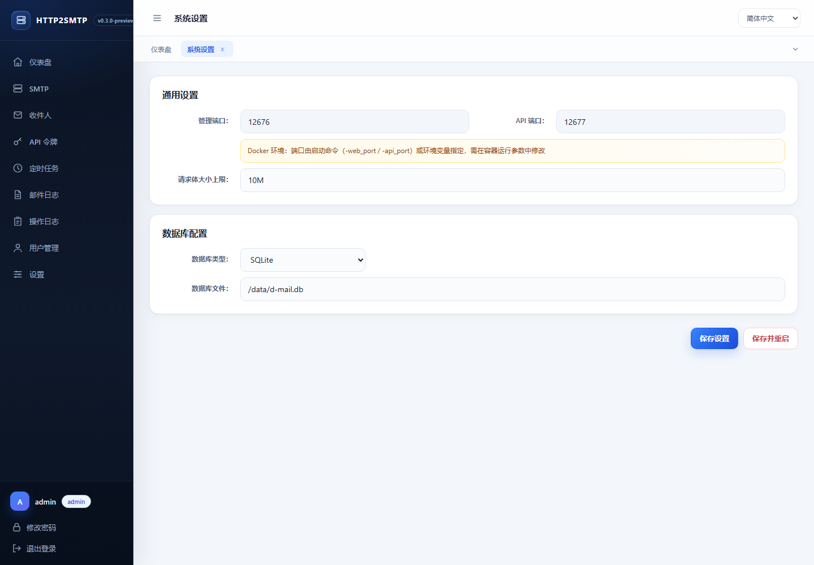
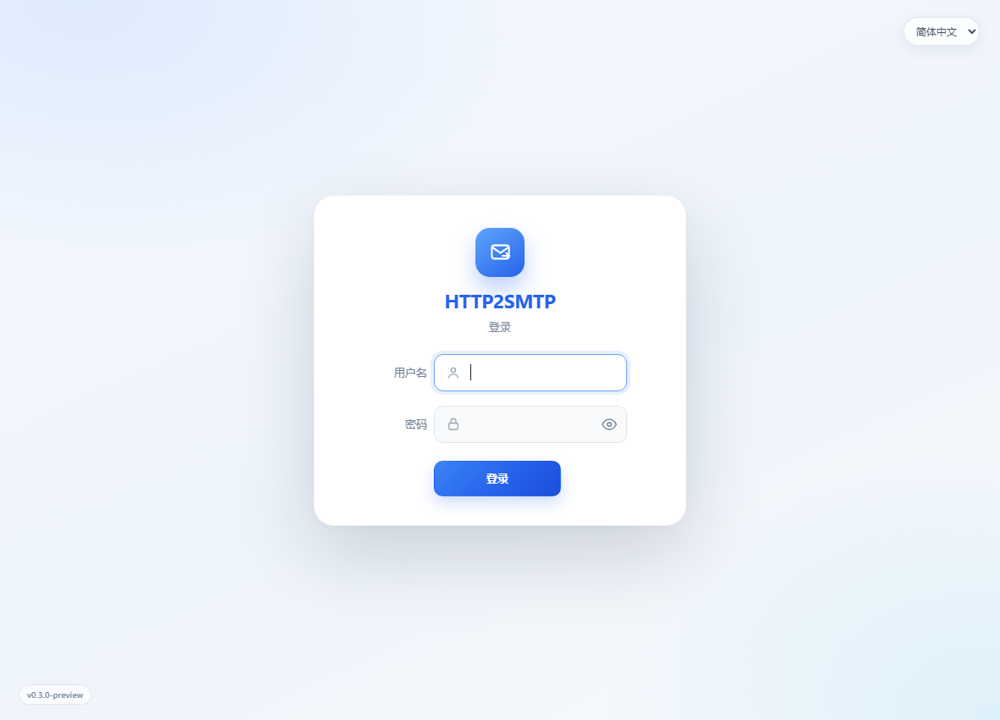
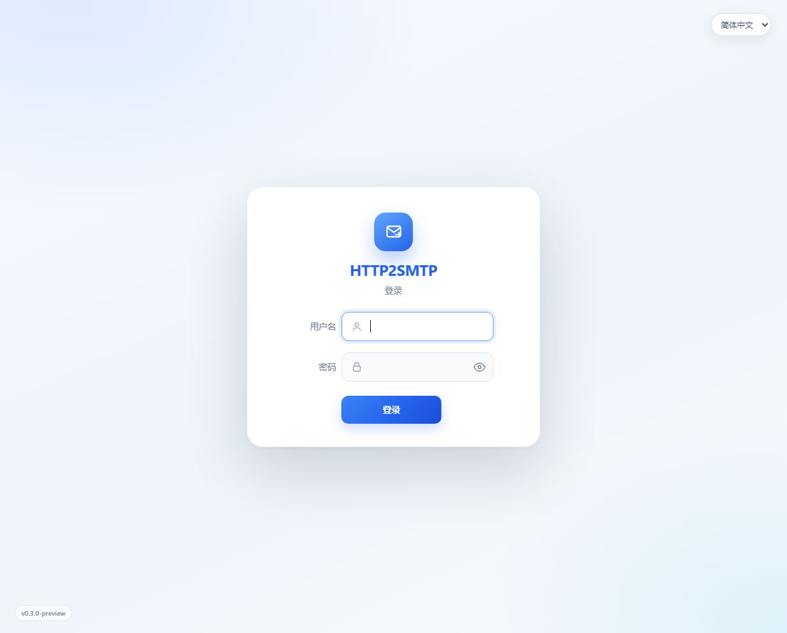

# HTTP2SMTP

**Send email through HTTP without hard-coding SMTP credentials in every application.**

[](https://github.com/chuccp/http2smtp/releases)
[](https://github.com/chuccp/http2smtp/actions/workflows/release.yml)
[](https://hub.docker.com/r/cooge123/http2smtp)
[](./go.mod)
[](./LICENSE)

**English** | [简体中文](./README_zh.md) | [繁體中文](./README.zh-TW.md) | [日本語](./README.ja.md)

HTTP2SMTP is a self-hosted HTTP-to-SMTP gateway. Manage SMTP servers, recipients, API
tokens and scheduled tasks from the web UI, then send mail from any application with a
simple HTTP request.

> [!IMPORTANT]
> This release is **not data-compatible with v0.2.x**. If an incompatible installation is
> detected, the service opens a management-only compatibility page with backup and reset
> instructions. The old database is not opened or modified. Read
> [Upgrading from v0.2.x](#upgrading-from-v02x) before upgrading.

## Highlights

- HTTP sending with JSON, form data or query parameters
- Multiple SMTP servers, contacts and API tokens
- Per-user ownership with administrator-wide management
- Scheduled HTTP requests with cron expressions and response templates
- HTML email templates and multiple attachments
- Mail history, attachment download and operation audit logs
- Click-shape login captcha using distinct, rotation-safe symbols
- Server-rendered UI with embedded templates and static files
- Chinese, Traditional Chinese, English and Japanese interfaces
- Docker image with one persistent `/data` volume
- GitHub releases with version and embedded UI verified automatically

## Screenshots

| Dashboard | Settings |
|---|---|
|  |  |

| Login | Setup |
|---|---|
|  |  |

## Quick Start

### Docker Compose

`docker/docker-compose.yml` mounts `docker/data` to `/data`, so configuration, SQLite,
logs and attachments survive container replacement.

```bash
cd docker
docker compose up -d
```

Open <http://127.0.0.1:12566> and complete the setup wizard.

### Docker Run

Linux or macOS:

```bash
docker pull cooge123/http2smtp

docker run -d --name http2smtp \
  -p 12566:12566 \
  -p 12567:12567 \
  -v "$PWD/data:/data" \
  cooge123/http2smtp
```

Windows PowerShell:

```powershell
docker run -d --name http2smtp `
  -p 12566:12566 `
  -p 12567:12567 `
  -v "${PWD}\data:/data" `
  cooge123/http2smtp
```

Check the container and ports:

```bash
docker inspect --format '{{.State.Health.Status}}' http2smtp
docker exec http2smtp nc -z -w 2 127.0.0.1 12566
docker exec http2smtp nc -z -w 2 127.0.0.1 12567
```

The built-in health check always probes the management port. In compatibility mode the
public API port is intentionally disabled, so the API-port check fails until the
installation is backed up and reset.

### Binary

Download the archive for your platform from
[GitHub Releases](https://github.com/chuccp/http2smtp/releases/latest).

Windows PowerShell:

```powershell
Invoke-WebRequest `
  -Uri "https://github.com/chuccp/http2smtp/releases/latest/download/http2smtp-windows-amd64.tar.gz" `
  -OutFile "http2smtp-windows-amd64.tar.gz"
tar -xzf http2smtp-windows-amd64.tar.gz
.\http2smtp.exe
```

Linux:

```bash
wget https://github.com/chuccp/http2smtp/releases/latest/download/http2smtp-linux-amd64.tar.gz
tar -xzf http2smtp-linux-amd64.tar.gz
chmod +x http2smtp
./http2smtp
```

The release archive contains only the binary. Templates, CSS, JavaScript, icons and
locale files are embedded inside it.

### Version

```bash
./http2smtp -v
./http2smtp --version
```

Example:

```text
http2smtp version v0.3.0 (linux/amd64)
```

The release workflow writes the Git tag into `version.go` before building, so published
binaries always contain their exact release version. Local builds show `dev` unless a
version is injected.

## First Run

1. Open the management page at <http://127.0.0.1:12566>.
2. Select SQLite or MySQL and test the connection.
3. Create the administrator account.
4. Add an SMTP server, recipients and an API token.
5. Send mail through the public API on port `12567`.

The management UI and admin API share port `12566`. The public mail API uses a separate
port `12567`, so it can be exposed without exposing the administration surface.

## Persistent Data

The container keeps all mutable data under `/data`:

```text
/data/
  config.ini
  d-mail.db                 # default SQLite database
  logs/
    http2smtp.log           # rotated by the built-in logger
  YYYY-MM-DD/               # attachment cache
```

When using MySQL, the database remains external, while configuration, logs and
attachments stay under `/data`.

For non-Docker deployments, `-storage_root` (or the `storage_root` environment variable)
sets the attachment root. A custom storage root also enables file logging at
`<storage_root>/logs/http2smtp.log`.

## Upgrading from v0.2.x

The data layout changed substantially. On startup HTTP2SMTP checks the persisted data
version before opening the database or running automatic table creation.

An unversioned installation or a mismatched data version starts a management-only
compatibility page. The database, models, scheduled jobs and public API do not start, and
the old data is not changed.

Before resetting:

1. Stop the old service.
2. Back up `config.ini`, the SQLite database, the attachment directory and application
   logs. For MySQL, take a full database dump.
3. Move `config.ini` out of the application directory.
4. Move the SQLite database to the backup location, or create a new empty MySQL database.
5. Start this release and complete the setup wizard.

HTTP2SMTP never deletes the old configuration, database or attachments automatically.
For Docker, back up the entire host directory mounted at `/data`.

## Public API

### Send Mail

`POST /sendMail` on the public API port (`12567` by default).

| Field | Type | Required | Description |
|---|---|---:|---|
| `token` | string | yes | API token created in the management UI |
| `subject` | string | no | Uses the token default when omitted |
| `content` | string | yes | Plain text or HTML mail content |
| `recipients` | string[] | no | Added to the token's configured recipients |
| `files` | object[] | no | Base64 file objects with `name` and `data` |

Configured recipients and request recipients are merged, and duplicate addresses are sent
only once. Malformed addresses are skipped. The request fails only when no usable
recipient remains.

JSON example:

```bash
curl -X POST 'http://127.0.0.1:12567/sendMail' \
  -H 'Content-Type: application/json' \
  -d '{
    "token": "YOUR_TOKEN",
    "subject": "Deployment finished",
    "content": "<b>Build 42 completed.</b>",
    "recipients": ["ops@example.com"],
    "files": [{
      "name": "result.txt",
      "data": "BASE64_CONTENT"
    }]
  }'
```

Form or multipart example:

```bash
curl -X POST 'http://127.0.0.1:12567/sendMail' \
  --form 'token=YOUR_TOKEN' \
  --form 'subject=Daily report' \
  --form 'content=Report attached' \
  --form 'recipients=ops@example.com' \
  --form 'files=@./report.pdf'
```

GET example:

```bash
curl 'http://127.0.0.1:12567/sendMail?token=YOUR_TOKEN&subject=test&content=hello'
```

Request-body size is controlled by `core.maxbodysize` (default `10M`; `-1` means
unlimited) and applies to JSON, form and multipart requests. The limit measures the
encoded body, so Base64 attachments require additional space.

## Configuration

Configuration precedence is:

`defaults` → `config.ini` → CLI flags → environment variables

Common startup flags:

```bash
./http2smtp \
  -web_port 12566 \
  -api_port 12567 \
  -storage_root /path/to/storage
```

A port supplied by a flag or `web_port` / `api_port` environment variable is treated as
fixed, which is how Docker prevents the UI from moving a mapped port.

Typical `config.ini`:

```ini
[core]
init = true
dbType = sqlite
dataVersion = 1
maxBodySize = 10M

[sqlite]
filename = d-mail.db

[manage]
port = 12566

[api]
port = 12567
```

For MySQL, use the `[mysql]` section with `host`, `port`, `dbname`, `username`,
`password` and `charset`.

Do not change `core.dataVersion` manually. It describes the complete on-disk layout and is
used by the compatibility guard.

## Build from Source

The project is a Go application with no Node/pnpm build step.

```bash
go test ./...
go build -tags release -o http2smtp ./
./http2smtp -v
```

An ordinary `go build` is a development build and reads templates/static assets from the
working tree. Release builds use `-tags release` and serve the embedded copies.

`webui/embed.go` packages the complete interface:

```go
//go:embed templates
var templatesFS embed.FS

//go:embed static
var staticFS embed.FS
```

The locale JSON files are embedded as well. The release workflow:

1. Verifies embedded templates and static files with `go test -tags release ./webui`.
2. Writes the pushed Git tag into `version.go`.
3. Builds every target with `-tags release`.
4. Uploads Actions artifacts and creates one GitHub Release.
5. Builds Docker images from the exact same release tag.

Latest builds are available from
[GitHub Releases](https://github.com/chuccp/http2smtp/releases) and
[Docker Hub](https://hub.docker.com/r/cooge123/http2smtp).

## Community

Telegram: <https://t.me/+JClG9_DojaM0ZGE1>

Issues and feature requests are welcome in
[GitHub Issues](https://github.com/chuccp/http2smtp/issues).

## License

Apache License 2.0. See [LICENSE](./LICENSE).
