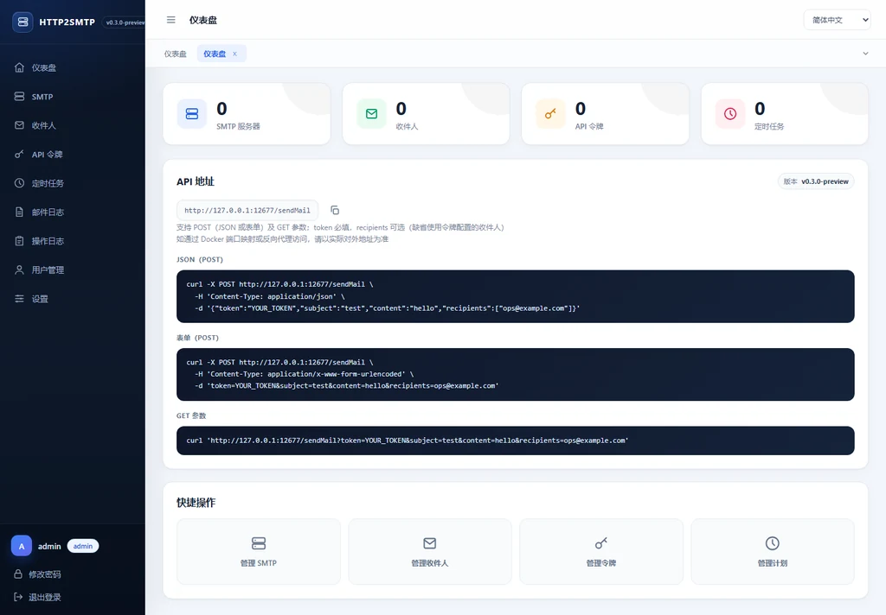
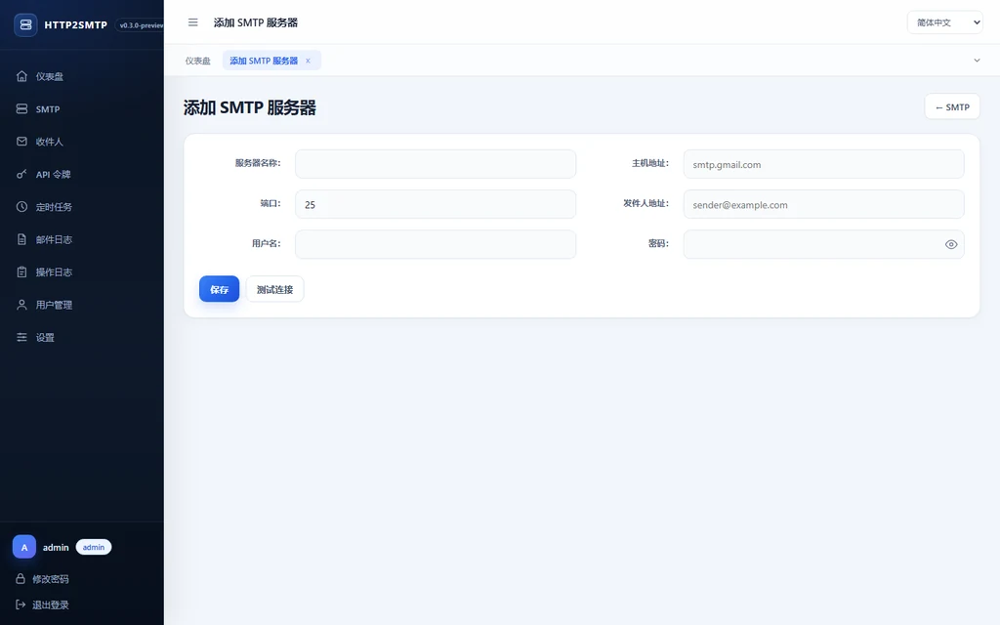
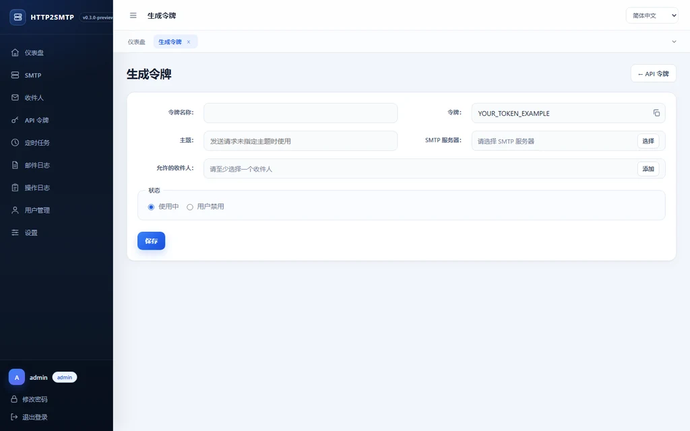
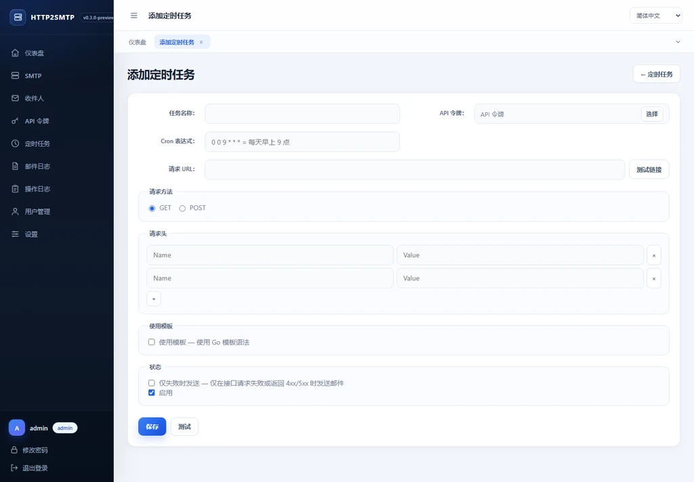

# HTTP2SMTP

**透過 HTTP 傳送郵件，無需在每個應用程式中硬編碼 SMTP 帳號。**

[](https://github.com/chuccp/http2smtp/releases)
[](https://github.com/chuccp/http2smtp/actions/workflows/release.yml)
[](https://hub.docker.com/r/cooge123/http2smtp)
[](./go.mod)
[](./LICENSE)

[English](./README.md) | [简体中文](./README_zh.md) | **繁體中文** | [日本語](./README.ja.md)

HTTP2SMTP 是一個可自託管的 HTTP 到 SMTP 閘道。你可以在管理介面中維護 SMTP
伺服器、收件人、API 權杖和排程工作，業務程式只需要傳送一個 HTTP 請求即可投遞郵件。

> [!IMPORTANT]
> 目前版本與 **v0.2.x 資料不相容**。偵測到舊版或資料版本不相符時，服務會進入只提供
> 管理頁面的相容模式，不會開啟或修改舊資料庫，並會在頁面中提示備份與重設步驟。
> 升級前請先閱讀[從 v0.2.x 升級](#從-v02x-升級)。

## 主要功能

- 支援 JSON、表單和 URL 參數傳送郵件
- 多個 SMTP 伺服器、收件人和 API 權杖
- 一般使用者資料隔離，管理員可管理全站資料
- Cron 排程請求、回應範本和失敗傳送策略
- HTML 郵件範本與多附件
- 郵件記錄、附件下載和操作稽核日誌
- 使用旋轉後仍清晰可辨圖形的新版點擊驗證碼
- 伺服器端渲染介面，範本和靜態檔案全部嵌入二進位檔
- 簡體中文、繁體中文、英文和日文介面
- Docker 單一目錄 `/data` 持久化
- GitHub 自動驗證嵌入資源、打包和發佈版本

## 介面截圖

| 儀表板 | 新增 SMTP 伺服器 |
|---|---|
|  |  |

| 產生 API 權杖 | 新增排程工作 |
|---|---|
|  |  |

## 快速開始

### Docker Compose

`docker/docker-compose.yml` 會把 `docker/data` 掛載到 `/data`，因此設定、SQLite、
日誌和附件在替換容器後仍會保留。

```bash
cd docker
docker compose up -d
```

開啟 <http://127.0.0.1:12566>，依照安裝精靈完成初始化。

### Docker Run

Windows PowerShell：

```powershell
docker pull cooge123/http2smtp

docker run -d --name http2smtp `
  -p 12566:12566 `
  -p 12567:12567 `
  -v "${PWD}\data:/data" `
  cooge123/http2smtp
```

Linux 或 macOS：

```bash
docker run -d --name http2smtp \
  -p 12566:12566 \
  -p 12567:12567 \
  -v "$PWD/data:/data" \
  cooge123/http2smtp
```

檢查容器和連接埠：

```bash
docker inspect --format '{{.State.Health.Status}}' http2smtp
docker exec http2smtp nc -z -w 2 127.0.0.1 12566
docker exec http2smtp nc -z -w 2 127.0.0.1 12567
```

內建健康檢查始終檢測管理連接埠。相容模式會依設計關閉公開 API，因此 API 連接埠測試
失敗是正常現象，完成備份和重設後才會恢復。

### 直接執行

從 [GitHub Releases](https://github.com/chuccp/http2smtp/releases/latest) 下載對應平台的
壓縮檔。

Windows PowerShell：

```powershell
Invoke-WebRequest `
  -Uri "https://github.com/chuccp/http2smtp/releases/latest/download/http2smtp-windows-amd64.tar.gz" `
  -OutFile "http2smtp-windows-amd64.tar.gz"
tar -xzf http2smtp-windows-amd64.tar.gz
.\http2smtp.exe
```

Linux：

```bash
wget https://github.com/chuccp/http2smtp/releases/latest/download/http2smtp-linux-amd64.tar.gz
tar -xzf http2smtp-linux-amd64.tar.gz
chmod +x http2smtp
./http2smtp
```

發佈壓縮檔中只有二進位檔，範本、CSS、JavaScript、圖示和語言檔案都已經嵌入其中。

### 查看版本

```bash
./http2smtp -v
./http2smtp --version
```

輸出範例：

```text
http2smtp version v0.3.0 (linux/amd64)
```

GitHub 發佈流程會在編譯前把 Git 標籤寫入 `version.go`，因此正式套件始終包含準確的
發佈版本；一般本機建置預設顯示 `dev`。

## 首次使用

1. 開啟管理頁面 <http://127.0.0.1:12566>。
2. 選擇 SQLite 或 MySQL，並測試資料庫連線。
3. 建立管理員帳號。
4. 新增 SMTP 伺服器、收件人和 API 權杖。
5. 透過 `12567` 連接埠的公開 API 傳送郵件。

管理介面和管理 API 共用 `12566` 連接埠；公開郵件 API 單獨使用 `12567` 連接埠，因此
可以只對外部開放郵件傳送介面。

## 持久化資料

Docker 容器把所有可變資料統一保存在 `/data`：

```text
/data/
  config.ini
  d-mail.db                 # 預設 SQLite 資料庫
  logs/
    http2smtp.log           # 內建日誌元件自動輪替
  YYYY-MM-DD/               # 附件快取
```

使用 MySQL 時，資料庫由外部 MySQL 保存；設定、日誌和附件仍放在 `/data`。

非 Docker 部署可以透過 `-storage_root` 參數或 `storage_root` 環境變數設定附件目錄。
使用自訂儲存目錄時，應用程式日誌會寫入
`<storage_root>/logs/http2smtp.log`。

## 從 v0.2.x 升級

新版資料配置變化較大，無法平滑升級。程式會在連線資料庫和自動建立資料表之前檢查
`core.dataVersion`。

遇到舊版設定、沒有版本標記的資料庫或資料版本不相符時：

- 只在原本的管理連接埠啟動相容提示頁面
- 不載入資料庫、模型、排程工作和公開 API
- 不讀取或修改舊資料庫
- 在頁面中顯示備份檔案、備份步驟和重設方式

重設前請執行以下操作：

1. 停止舊版服務。
2. 完整備份 `config.ini`、SQLite 資料庫、附件目錄和應用程式日誌；MySQL 使用者請執行
   完整資料庫備份。
3. 將 `config.ini` 移出程式目錄。
4. 將 SQLite 資料庫移到備份位置，或建立一個新的空白 MySQL 資料庫。
5. 啟動目前版本，重新完成安裝精靈。

HTTP2SMTP 不會自動刪除舊設定、資料庫或附件。Docker 使用者請完整備份掛載到 `/data`
的主機目錄。

## 公開 API

### 傳送郵件

`POST /sendMail`，預設使用公開 API 連接埠 `12567`。

| 欄位 | 類型 | 必填 | 說明 |
|---|---|---:|---|
| `token` | string | 是 | 管理介面建立的 API 權杖 |
| `subject` | string | 否 | 未填寫時使用權杖預設主旨 |
| `content` | string | 是 | 純文字或 HTML 郵件內容 |
| `recipients` | string[] | 否 | 追加到權杖設定的收件人 |
| `files` | object[] | 否 | 包含 `name` 和 Base64 `data` 的附件 |

權杖設定的收件人和請求中的收件人會合併，重複地址只傳送一次。格式錯誤的地址會被
略過；只有在沒有可用收件人時請求才會失敗。

JSON 範例：

```bash
curl -X POST 'http://127.0.0.1:12567/sendMail' \
  -H 'Content-Type: application/json' \
  -d '{
    "token": "YOUR_TOKEN",
    "subject": "部署完成",
    "content": "<b>建置 42 已完成。</b>",
    "recipients": ["ops@example.com"],
    "files": [{
      "name": "result.txt",
      "data": "BASE64_CONTENT"
    }]
  }'
```

表單或 multipart 範例：

```bash
curl -X POST 'http://127.0.0.1:12567/sendMail' \
  --form 'token=YOUR_TOKEN' \
  --form 'subject=每日報表' \
  --form 'content=報表見附件' \
  --form 'recipients=ops@example.com' \
  --form 'files=@./report.pdf'
```

GET 範例：

```bash
curl 'http://127.0.0.1:12567/sendMail?token=YOUR_TOKEN&subject=test&content=hello'
```

請求本文大小由 `core.maxbodysize` 控制，預設 `10M`，支援 `K/M/G` 後綴，`-1` 表示不限制。
JSON、表單和 multipart 請求都受此限制約束；限制以編碼後的請求本文計算，因此 Base64
附件需要額外空間。

## 設定

設定優先順序：

`預設值` → `config.ini` → 命令列參數 → 環境變數

常用啟動參數：

```bash
./http2smtp \
  -web_port 12566 \
  -api_port 12567 \
  -storage_root /path/to/storage
```

透過參數或 `web_port` / `api_port` 環境變數指定的連接埠會被視為固定連接埠，Docker
正是透過這種方式防止設定頁改變連接埠對應。

典型 `config.ini`：

```ini
[core]
init = true
dbType = sqlite
dataVersion = 1
maxBodySize = 10M

[sqlite]
filename = d-mail.db

[manage]
port = 12566

[api]
port = 12567
```

使用 MySQL 時，需要設定 `[mysql]` 下的 `host`、`port`、`dbname`、`username`、
`password` 和 `charset`。

不要手動修改 `core.dataVersion`。它表示完整的磁碟資料格式，由相容性檢查使用。

## 從原始碼建置

專案使用 Go 伺服器端範本，不需要 Node/pnpm 建置步驟。

```bash
go test ./...
go build -tags release -o http2smtp ./
./http2smtp -v
```

一般 `go build` 是開發建置，會從工作目錄讀取範本和靜態資源；正式建置使用
`-tags release`，直接使用嵌入副本，可以從任意目錄執行。

`webui/embed.go` 負責把完整介面打包進二進位檔：

```go
//go:embed templates
var templatesFS embed.FS

//go:embed static
var staticFS embed.FS
```

四個語言 JSON 也會嵌入。GitHub 發佈流程會：

1. 使用 `go test -tags release ./webui` 驗證範本和靜態資源。
2. 把推送的 Git 標籤寫入 `version.go`。
3. 使用 `-tags release` 建置全部平台產物。
4. 彙整 Actions artifact 並統一建立 GitHub Release。
5. 使用同一個 Release 標籤建置 Docker 映像。

最新建置可從 [GitHub Releases](https://github.com/chuccp/http2smtp/releases) 和
[Docker Hub](https://hub.docker.com/r/cooge123/http2smtp) 取得。

## 社群

Telegram：<https://t.me/+JClG9_DojaM0ZGE1>

歡迎在 [GitHub Issues](https://github.com/chuccp/http2smtp/issues) 提交問題與建議。

## 授權條款

Apache License 2.0，詳見 [LICENSE](./LICENSE)。
