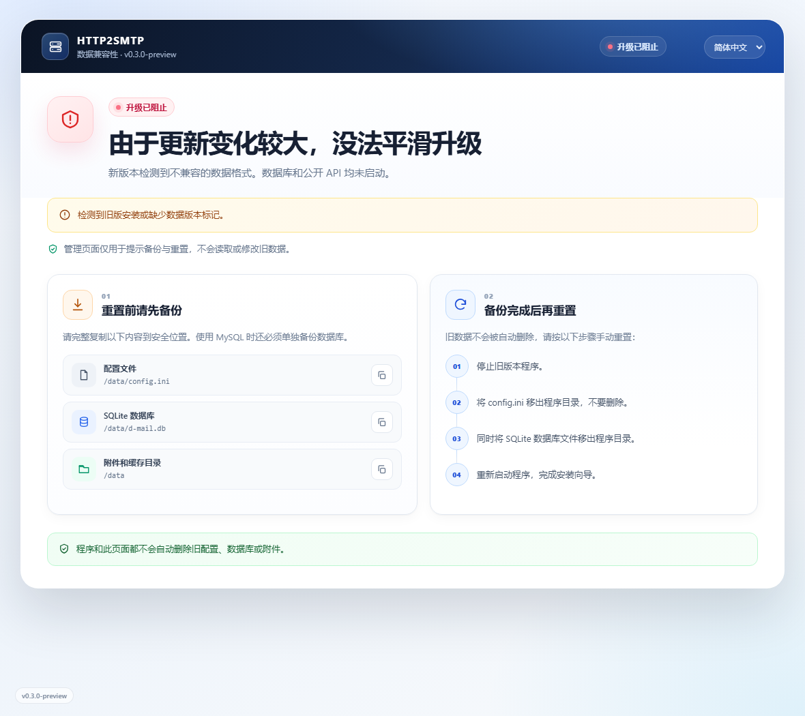

# HTTP2SMTP

**通过 HTTP 发送邮件，无需在每个应用中硬编码 SMTP 账号。**

[](https://github.com/chuccp/http2smtp/releases)
[](https://github.com/chuccp/http2smtp/actions/workflows/release.yml)
[](https://hub.docker.com/r/cooge123/http2smtp)
[](./go.mod)
[](./LICENSE)

[English](./README.md) | **简体中文** | [繁體中文](./README.zh-TW.md) | [日本語](./README.ja.md)

HTTP2SMTP 是一个可自托管的 HTTP 到 SMTP 网关。你可以在管理界面中维护 SMTP
服务器、收件人、API 令牌和定时任务，业务程序只需要发送一个 HTTP 请求即可投递邮件。

> [!IMPORTANT]
> 当前版本与 **v0.2.x 数据不兼容**。检测到旧版或数据版本不匹配时，服务会进入只提供
> 管理页面的兼容模式，不会打开或修改旧数据库，并会在页面中提示备份与重置步骤。
> 升级前请先阅读[从 v0.2.x 升级](#从-v02x-升级)。

## 主要功能

- 支持 JSON、表单和 URL 参数发送邮件
- 多个 SMTP 服务器、收件人和 API 令牌
- 普通用户数据隔离，管理员可管理全站数据
- Cron 定时请求、响应模板和失败发送策略
- HTML 邮件模板与多附件
- 邮件记录、附件下载和操作审计日志
- 使用旋转后仍清晰可辨图形的新版点击验证码
- 服务端渲染界面，模板和静态文件全部嵌入二进制
- 简体中文、繁体中文、英文和日文界面
- Docker 单目录 `/data` 持久化
- GitHub 自动验证嵌入资源、打包和发布版本

## 界面截图

| 仪表盘 | 系统设置 |
|---|---|
|  |  |

| 登录 | 安装向导 |
|---|---|
|  |  |

**数据不兼容与重置提示**



## 快速开始

### Docker Compose

`docker/docker-compose.yml` 会把 `docker/data` 挂载到 `/data`，因此配置、SQLite、
日志和附件在替换容器后仍会保留。

```bash
cd docker
docker compose up -d
```

打开 <http://127.0.0.1:12566>，按安装向导完成初始化。

### Docker Run

Windows PowerShell：

```powershell
docker pull cooge123/http2smtp

docker run -d --name http2smtp `
  -p 12566:12566 `
  -p 12567:12567 `
  -v "${PWD}\data:/data" `
  cooge123/http2smtp
```

Linux 或 macOS：

```bash
docker run -d --name http2smtp \
  -p 12566:12566 \
  -p 12567:12567 \
  -v "$PWD/data:/data" \
  cooge123/http2smtp
```

检查容器和端口：

```bash
docker inspect --format '{{.State.Health.Status}}' http2smtp
docker exec http2smtp nc -z -w 2 127.0.0.1 12566
docker exec http2smtp nc -z -w 2 127.0.0.1 12567
```

内置健康检查始终检测管理端口。兼容模式会按设计关闭公开 API，因此 API 端口测试失败
是正常现象，完成备份和重置后才会恢复。

### 直接运行

从 [GitHub Releases](https://github.com/chuccp/http2smtp/releases/latest) 下载对应平台的
压缩包。

Windows PowerShell：

```powershell
Invoke-WebRequest `
  -Uri "https://github.com/chuccp/http2smtp/releases/latest/download/http2smtp-windows-amd64.tar.gz" `
  -OutFile "http2smtp-windows-amd64.tar.gz"
tar -xzf http2smtp-windows-amd64.tar.gz
.\http2smtp.exe
```

Linux：

```bash
wget https://github.com/chuccp/http2smtp/releases/latest/download/http2smtp-linux-amd64.tar.gz
tar -xzf http2smtp-linux-amd64.tar.gz
chmod +x http2smtp
./http2smtp
```

发布压缩包中只有二进制文件，模板、CSS、JavaScript、图标和语言文件都已经嵌入其中。

### 查看版本

```bash
./http2smtp -v
./http2smtp --version
```

输出示例：

```text
http2smtp version v0.3.0 (linux/amd64)
```

GitHub 发布流程会在编译前把 Git 标签写入 `version.go`，因此正式包始终包含准确的发布
版本；普通本地构建默认显示 `dev`。

## 首次使用

1. 打开管理页面 <http://127.0.0.1:12566>。
2. 选择 SQLite 或 MySQL，并测试数据库连接。
3. 创建管理员账号。
4. 添加 SMTP 服务器、收件人和 API 令牌。
5. 通过 `12567` 端口的公开 API 发送邮件。

管理界面和管理 API 共用 `12566` 端口；公开邮件 API 单独使用 `12567` 端口，因此可以
只向外部开放邮件发送接口。

## 持久化数据

Docker 容器把所有可变数据统一保存在 `/data`：

```text
/data/
  config.ini
  d-mail.db                 # 默认 SQLite 数据库
  logs/
    http2smtp.log           # 内置日志组件自动轮转
  YYYY-MM-DD/               # 附件缓存
```

使用 MySQL 时，数据库由外部 MySQL 保存；配置、日志和附件仍放在 `/data`。

非 Docker 部署可以通过 `-storage_root` 参数或 `storage_root` 环境变量设置附件目录。
使用自定义存储目录时，应用日志会写入
`<storage_root>/logs/http2smtp.log`。

## 从 v0.2.x 升级

新版数据布局变化较大，无法平滑升级。程序会在连接数据库和自动建表之前检查
`core.dataVersion`。

遇到旧版配置、没有版本标记的数据库或数据版本不匹配时：

- 只在原管理端口启动兼容提示页面
- 不加载数据库、模型、定时任务和公开 API
- 不读取或修改旧数据库
- 在页面中展示备份文件、备份步骤和重置方式

重置前请执行以下操作：

1. 停止旧版本服务。
2. 完整备份 `config.ini`、SQLite 数据库、附件目录和应用日志；MySQL 用户请执行完整
   数据库备份。
3. 将 `config.ini` 移出程序目录。
4. 将 SQLite 数据库移到备份位置，或新建一个空的 MySQL 数据库。
5. 启动当前版本，重新完成安装向导。

HTTP2SMTP 不会自动删除旧配置、数据库或附件。Docker 用户请完整备份挂载到 `/data`
的宿主机目录。

## 公开 API

### 发送邮件

`POST /sendMail`，默认使用公开 API 端口 `12567`。

| 字段 | 类型 | 必填 | 说明 |
|---|---|---:|---|
| `token` | string | 是 | 管理界面创建的 API 令牌 |
| `subject` | string | 否 | 未填写时使用令牌默认主题 |
| `content` | string | 是 | 纯文本或 HTML 邮件内容 |
| `recipients` | string[] | 否 | 追加到令牌配置的收件人 |
| `files` | object[] | 否 | 包含 `name` 和 Base64 `data` 的附件 |

令牌配置的收件人和请求中的收件人会合并，重复地址只发送一次。格式错误的地址会被
跳过；只有在没有可用收件人时请求才会失败。

JSON 示例：

```bash
curl -X POST 'http://127.0.0.1:12567/sendMail' \
  -H 'Content-Type: application/json' \
  -d '{
    "token": "YOUR_TOKEN",
    "subject": "部署完成",
    "content": "<b>构建 42 已完成。</b>",
    "recipients": ["ops@example.com"],
    "files": [{
      "name": "result.txt",
      "data": "BASE64_CONTENT"
    }]
  }'
```

表单或 multipart 示例：

```bash
curl -X POST 'http://127.0.0.1:12567/sendMail' \
  --form 'token=YOUR_TOKEN' \
  --form 'subject=每日报表' \
  --form 'content=报表见附件' \
  --form 'recipients=ops@example.com' \
  --form 'files=@./report.pdf'
```

GET 示例：

```bash
curl 'http://127.0.0.1:12567/sendMail?token=YOUR_TOKEN&subject=test&content=hello'
```

请求体大小由 `core.maxbodysize` 控制，默认 `10M`，支持 `K/M/G` 后缀，`-1` 表示不限制。
JSON、表单和 multipart 请求都受该限制约束；限制按编码后的请求体计算，因此 Base64
附件需要额外空间。

## 配置

配置优先级：

`默认值` → `config.ini` → 命令行参数 → 环境变量

常用启动参数：

```bash
./http2smtp \
  -web_port 12566 \
  -api_port 12567 \
  -storage_root /path/to/storage
```

通过参数或 `web_port` / `api_port` 环境变量指定的端口会被视为固定端口，Docker 正是
通过这种方式防止设置页改变端口映射。

典型 `config.ini`：

```ini
[core]
init = true
dbType = sqlite
dataVersion = 1
maxBodySize = 10M

[sqlite]
filename = d-mail.db

[manage]
port = 12566

[api]
port = 12567
```

使用 MySQL 时，需要配置 `[mysql]` 下的 `host`、`port`、`dbname`、`username`、
`password` 和 `charset`。

不要手动修改 `core.dataVersion`。它表示完整的磁盘数据格式，由兼容性检查使用。

## 从源码构建

项目使用 Go 服务端模板，不需要 Node/pnpm 构建步骤。

```bash
go test ./...
go build -tags release -o http2smtp ./
./http2smtp -v
```

普通 `go build` 是开发构建，会从工作目录读取模板和静态资源；正式构建使用
`-tags release`，直接使用嵌入副本，可以从任意目录运行。

`webui/embed.go` 负责把完整界面打包进二进制：

```go
//go:embed templates
var templatesFS embed.FS

//go:embed static
var staticFS embed.FS
```

四个语言 JSON 也会嵌入。GitHub 发布流程会：

1. 使用 `go test -tags release ./webui` 验证模板和静态资源。
2. 把推送的 Git 标签写入 `version.go`。
3. 使用 `-tags release` 构建全部平台产物。
4. 汇总 Actions artifact 并统一创建 GitHub Release。
5. 使用同一个 Release 标签构建 Docker 镜像。

最新构建可从 [GitHub Releases](https://github.com/chuccp/http2smtp/releases) 和
[Docker Hub](https://hub.docker.com/r/cooge123/http2smtp) 获取。

## 社区

Telegram：<https://t.me/+JClG9_DojaM0ZGE1>

欢迎在 [GitHub Issues](https://github.com/chuccp/http2smtp/issues) 提交问题与建议。

## 许可证

Apache License 2.0，详见 [LICENSE](./LICENSE)。
